# Speech Emotion Router: Affective Audio Classification

<figure align="center">
  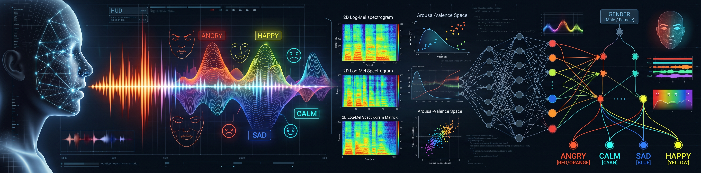
  <figcaption align="center"><em>generated by Gemini</em></figcaption>
</figure>

## Overview

My core research objective is to investigate: **Given an audio voice sample, can a machine learning model reliably identify broad traits of the speaker, specifically gender and emotional state, similar to human perception?**

- In critical communication streams like emergency dispatch lines and customer support centers, callers frequently exhibit high-stress escalations and subtle cues of distress that go unnoticed during manual triage.
- Automated speech perception provides an operational routing mechanism to detect frustration early, enabling immediate escalation to specialized teams.
- Beyond enterprise triage, this capability supports assistive accessibility technologies: hard-of-hearing and neurodivergent individuals (such as those on the autism spectrum) often face barriers interpreting tone and affect from vocal acoustics alone.

An affective classification engine can dynamically enrich real-time captions with emotional context, translating raw sound into actionable social signals.

To answer this question without models simply memorizing individual speaker timbres, this project evaluates acoustic models under a strict **speaker-independent validation framework** (partitioning training and evaluation by speaker identity). The analysis follows a progressive modeling strategy:

- **Baseline & Classical Acoustic Models:** Evaluating linear and kernel-based estimators on standardized tabular audio features (such as Mel-Frequency Cepstral Coefficients) to establish benchmark discrimination.
- **Deep Representation Learning:** Advancing to convolutional neural architectures trained on continuous time-frequency representations to capture subtle temporal inflections, pauses, and pitch dynamics.
- **Empirical Target Milestones:** Benchmarking performance against theoretical chance baselines, aiming for >90% accuracy on binary gender separation and 50-60%+ accuracy/macro-F1 on multi-class emotion classification when evaluated on completely unseen speakers.

While the broader architectural goal is designed to generalize across North American English speech datasets (such as RAVDESS and CREMA-D), this implementation establishes its initial benchmarks, acoustic hygiene, and feature extraction pipeline on the RAVDESS corpus.

---

## Notebooks

### 1. *Metadata Distribution & Dataset Profiling*

&emsp;&emsp;[`notebooks/00_metadata_eda.ipynb`](./notebooks/00_metadata_eda.ipynb)

- Dataset structure validation across 1,440 audio speech trials (24 professional actors, balanced 12M/12F).
- Target mapping for joint gender-emotion classification (16 classes) and validation split planning.

### 2. *Acoustic Hygiene, Signal Auditing & Feature Extraction*

&emsp;&emsp;[`notebooks/01_signal_eda_features.ipynb`](./notebooks/01_signal_eda_features.ipynb)

- Lead/trail silence trimming via logarithmic decibel calibration (`top_db=25`).
- Hardware cleanliness checks: DC offset drift, digital clipping, and peak amplitude verification.
- Duration variance and outlier analysis across statements, vocal intensities, and emotional categories.
- Frame-level 13-band MFCC extraction and static tabular aggregation (26-dimensional mean and standard deviation).

### 3. *Baseline Modeling & Error Diagnostics*

&emsp;&emsp;[`notebooks/02_baseline_modeling.ipynb`](./notebooks/02_baseline_modeling.ipynb)

- Leak-free 5-fold `StratifiedGroupKFold` cross-validation grouped strictly by actor ID.
- Empirical heuristic baseline (`DummyClassifier` ~6.25%) and regularized linear baseline (`LogisticRegression` 38.82%).
- Confusion matrix error auditing demonstrating gender disentanglement vs. intra-gender acoustic confusion.
- Serialization of fitted baseline pipelines and out-of-fold predictions to checkpointed artifacts.

### 4. *Non-Linear Tabular Modeling & Support Vector Machines*

&emsp;&emsp;[`notebooks/03_svc_modeling.ipynb`](./notebooks/03_svc_modeling.ipynb)

- Non-linear boundary projection via kernelized Support Vector Classification (`SVC` with RBF kernel).
- Evaluation under identical 5-fold speaker-partitioned splits, reaching **43.13%** 16-class compound accuracy.
- Out-of-fold probability calibration and error analysis across acoustically adjacent emotional pairs.
- Serialization of Phase 03 evaluation artifacts (`03_1_svc_evaluation_bundle.joblib`).

### 5. *Spectral Representation & 2D Tensor Engineering*

&emsp;&emsp;[`notebooks/04_spectrogram_extraction.ipynb`](./notebooks/04_spectrogram_extraction.ipynb)

- Short-Time Fourier Transform (STFT) conversion to $128 \times 128$ Log-Mel spectrogram matrices.
- Dynamic audio centering/padding and decibel scaling for convolutional visual inputs.
- Target label alignment with compound identifiers (`f"{gender}_{emotion}"`) and serialization to compressed `.npz` archive (`04_spectrogram_tensors.npz`).

### 6. *Deep Learning & 2D Convolutional Neural Network*

&emsp;&emsp;[`notebooks/05_cnn.ipynb`](./notebooks/05_cnn.ipynb)

- 2-block VGG convolutional architecture (`Conv2D` $\to$ `BatchNormalization` $\to$ `MaxPooling` $\to$ `GlobalAveragePooling2D`).
- Out-of-fold cross-validation with `EarlyStopping` monitoring validation loss across unseen test actors.
- Final cross-paradigm benchmark comparison against tabular baselines (30.07% compound accuracy, 87.22% gender separation).
- Serialization of final OOF predictions and evaluation bundle (`05_cnn_evaluation_bundle.joblib`).

---

## Repository Structure

```text
.
├── README.md                                        # Executive overview, benchmarks, and retrospective
├── data/
│   ├── processed/
│   │   ├── 00_ravdess_metadata.csv                  # Parsed filename metadata
│   │   ├── 01_1_df_metadata_with_duration.parquet   # Audio lengths audit
│   │   ├── 01_2_duration_outliers_w_silence.parquet # Outlier & silence audit
│   │   ├── 01_3_df_cleaned.parquet                  # Cleaned trial dataset
│   │   ├── ser_features.parquet                     # 26-MFCC tabular feature matrix
│   │   ├── models/
│   │   │   ├── 02_2_baseline_pipelines.joblib       # LR & Dummy OOF pipelines
│   │   │   ├── 03_1_svc_evaluation_bundle.joblib   # RBF-SVC pipeline & OOF metrics
│   │   │   └── 05_cnn_evaluation_bundle.joblib     # 2D CNN OOF predictions & metrics
│   │   └── spectrograms/
│   │       └── 04_spectrogram_tensors.npz           # 128x128 Log-Mel tensors (npz)
│   └── raw/
│       └── RAVDESS/                                 # [gitignored] Raw audio dataset
│           ├── Audio_Speech_Actors_01-24/           # 24 actor folders (1,440 files)
│           └── README.md                            # Dataset documentation
├── docs/
│   ├── 01_problem_scoping.pdf                       # Project scoping brief
│   └── 02_problem_statement.pdf                     # Formal problem statement
├── notebooks/
│   ├── 00_metadata_eda.ipynb                        # Metadata distribution analysis
│   ├── 01_signal_eda_features.ipynb                 # Signal audit & MFCC extraction
│   ├── 02_baseline_modeling.ipynb                   # Linear baseline & error audits
│   ├── 03_svc_modeling.ipynb                        # Kernelized RBF-SVC modeling
│   ├── 04_spectrogram_extraction.ipynb              # Log-Mel 2D tensor generation
│   └── 05_cnn.ipynb                                 # 2D CNN pipeline & final benchmark
├── outputs/                                         # Evaluation plots & confusion matrices
├── git-prefix.sh                                    # Git commit message hook
└── .gitignore                                       # Repository exclusions
```

## Phase 0 and 1: Data Cleaning & Acoustic Exploratory Data Analysis (EDA)

The speech corpus under initial analysis contains 1,440 recordings across 24 professional actors (12 male, 12 female) vocalizing two standardized statements under controlled recording studio conditions.

### Dataset Integrity & Cleanliness Auditing

- **Missing Values & Nulls:** Audited the full metadata index across all 1,440 records; zero missing values, null entries, or corrupted identifiers were found.
- **Duplicate Records:** Confirmed that all 1,440 audio files correspond to unique trials across actor, emotion, vocal intensity, statement, and repetition dimensions.
- **Target Distribution:** Verified balanced class representation across genders (720 male, 720 female) and emotional categories (192 trials per emotion, with 96 trials for neutral due to single-take recordings).

### Signal Hygiene & Cleanliness Checks

Before extracting acoustic features, an automated digital signal hygiene audit evaluated the physical recording quality across all 1,440 raw audio files:

- **Digital Saturation Clipping (`clipped_samples`):** Checked sample values against digital limits ($\pm 1.0$); zero clipped samples were found across the entire dataset.
- **Direct Current Bias (`dc_offset`):** Audited the mean amplitude offset to detect hardware analog-to-digital converter drift; all files showed negligible DC offset ($\vert{}\mu\vert{} < 10^{-4}$), making destructive high-pass filtering unnecessary.
- **Peak Amplitudes (`max_abs_amp`):** Checked amplitude headroom; recordings demonstrated consistent gain staging without hardware distortion.

### Silence Auditing & Trimming

Analysis of raw waveform timing revealed substantial leading and trailing studio silence:

- **Silence Proportion:** Studio buffer silence accounted for an average of 53.2% of raw file duration (roughly 1.0s of non-speech per clip).
- **Decibel Threshold Calibration:** Calibrated a -25 dB silence floor (`top_db=25`) using `librosa.effects.trim` to strip lead and trail buffers without clipping quiet consonant onsets.

<!-- WhiteSpace Audio Extract -->
<figure align="center">
  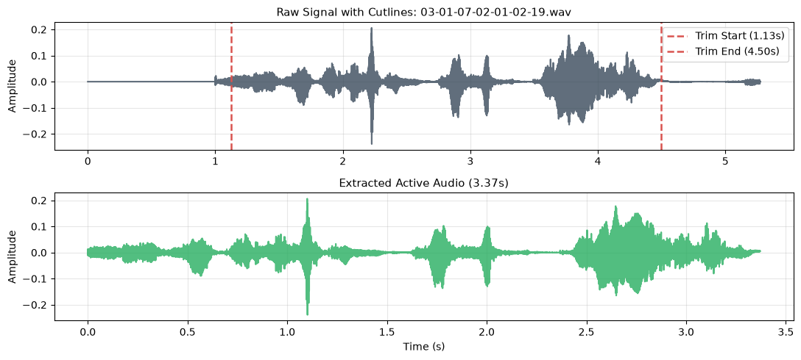
  <figcaption><em>Fig: Extracted Audio using Whitespace Trimming</em></figcaption>
</figure>

- **Active Utterance Isolation:** Trimming reduced average clip duration to an active speech mean of 1.74s, removing non-informative ambient room noise from downstream feature extractions.

### Duration & Outlier Analysis

Auditing the trimmed duration distributions across dataset facets provided empirical justification for retaining all recordings:

- **Lexical & Gender Invariance:** Statement length and actor gender showed no statistically meaningful duration differences.
- **Emotional Modulation:** Duration variance was driven primarily by emotional state and vocal intensity (such as drawn-out vowels in sad and calm states versus rapid bursts in angry states).

<!-- Out-of-Fold 16-Class Confusion Matrix -->
<figure align="center">
  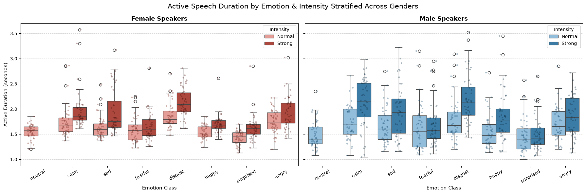
  <figcaption><em>Fig: Complete Audio Distribution Post-Trim</em></figcaption>
</figure>

- **Outlier Retention Verdict:** Because prolonged trials reflected genuine vocal expressions rather than recording corruption or silence trimming errors, all 1,440 trials were kept without artificial truncation or row dropping.

## Phase 1: Feature Extraction & Engineering

Converting raw audio waveforms into model-ready numerical inputs requires capturing spectral energy distributions without carrying background room noise or allowing identity leakage.

### Acoustic Representation: 13-Band MFCCs

Mel-Frequency Cepstral Coefficients (MFCCs) serve as the primary acoustic feature representation because they compress spectral power distributions onto a logarithmic pitch scale that approximates human auditory frequency perception:

- **Audio Standardization:** Audio signals are loaded at a standardized 22,050 Hz sampling rate, preserving frequencies up to 11 kHz to capture human vocal tract formants and pitch harmonics.

- **Short-Time Spectral Decomposition:** Applied a Short-Time Fourier Transform (STFT) with a 2,048-sample window length and a 512-sample hop length (75% frame overlap) across the trimmed active speech.

- **Mel Filterbank Projection:** Projected power spectrograms onto 13 discrete Mel-frequency bands, applying discrete cosine transformation (DCT) to decorrelate filterbank energies into 13 dynamic MFCC contours.

- **Acoustic Semantic Mapping:** Rather than treating coefficients as black-box numbers, each cepstral index maps directly to physical acoustic properties of speech production:
  - **C_0 (Log Energy / Loudness):** Overall signal energy and vocal volume.
  - **C_1 (Macro Spectral Tilt):** Ratio of low-to-high frequency power, reflecting vocal brightness or breathiness.
  - **C_2 to C_3 (Vocal Tract Resonances):** Low and mid formant locations shaped by tongue height, jaw opening, and biological vocal tract length.
  - **C_4 to C_9 (Formant Textures & Harmonics):** Rich harmonic structures that capture timbre, nasal resonance, and vocal tract constriction.
  - **C_10 to C_12 (Fine Spectral Envelopes):** Upper-frequency spectral detail, consonant friction, and micro-prosody.

#### Empirical Cross-Gender MFCC Profiling

To ground these acoustic meanings in empirical data, spot-auditing matched speech trials across male and female vocalizations reveals substantial baseline shifts driven by biological vocal tract geometry:

| Coefficient | Acoustic Meaning | Actor 17 (Male) | Actor 18 (Female) |
| :---: | :--- | :---: | :---: |
| **C_0** | Energy / Loudness | -379.13 | -460.80 |
| **C_1** | Macro Tilt | 107.40 | 99.49 |
| **C_2** | Low Resonance | -15.97 | -32.34 |
| **C_3** | Mid Resonance | 20.16 | 11.03 |
| **C_4** | Texture | -1.86 | -26.59 |
| **C_5** | Texture | 20.68 | 8.10 |
| **C_6** | Texture | -5.70 | -27.12 |
| **C_7** | Texture | 6.25 | -9.00 |
| **C_8** | Texture | -5.90 | -15.42 |
| **C_9** | Texture | -2.07 | -19.95 |
| **C_10** | Fine Shape | -11.20 | -17.91 |
| **C_11** | Fine Shape | 1.07 | -3.96 |
| **C_12** | Fine Shape | 3.57 | -5.32 |

- **Gender Separation Mechanism:** Lower coefficients (particularly C_2 through C_6) exhibit marked mean divergence between male and female speakers (e.g., C_4 shifting from -1.86 to -26.59, and C_6 from -5.70 to -27.12). Shorter female vocal tract lengths shift formant resonances upward, producing distinct cepstral signatures that explain why linear models achieve ~94.5% gender separation.

<!-- Placeholder: Cross-Emotion & Cross-Gender MFCC Dynamic Comparison (Actor 22 vs Actor 23) -->
<figure align="center">
  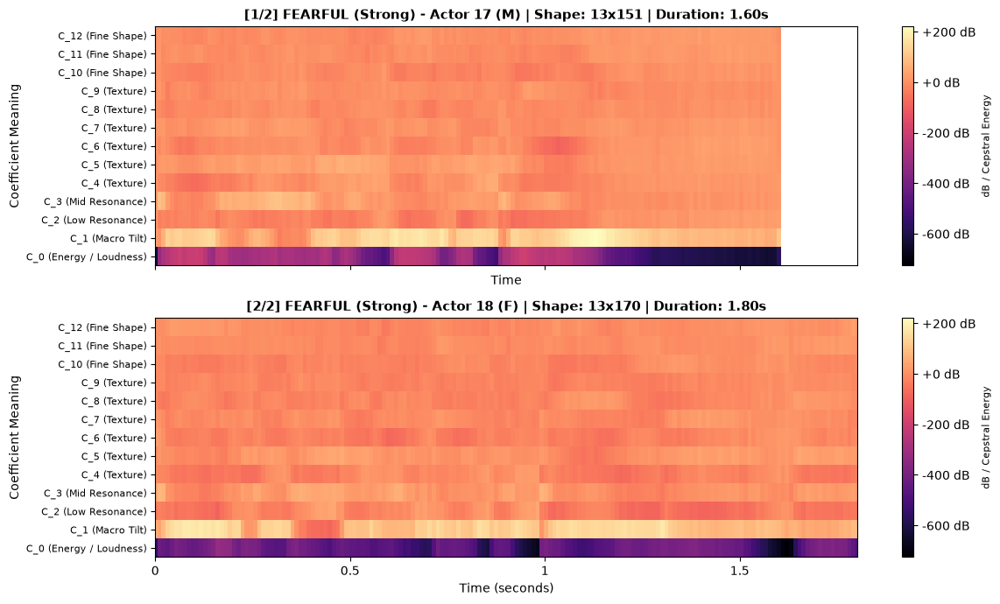
  <figcaption><em>Fig: Dynamic 13-band MFCC spectrogram comparison and cepstral trajectory audit across male and female speakers expressing matched strong affective states.</em></figcaption>
</figure>

### Tabular Dimensionality Reduction: Mean & Standard Deviation

Because classical classification models require fixed-dimensional inputs rather than variable-length time series arrays, dynamic frame-level trajectories were condensed into static summary statistics:

- **Curse of Dimensionality Prevention:** Flattening the entire uncollapsed time-series array directly into tabular columns would cause the feature space to explode. For a typical utterance spanning ~150 to 200 time steps, flattening 13 MFCC bands yields over 2,000 to 2,600 features per sample, heavily outstripping the 1,440 trial dataset size ($p > n$) and causing severe tabular overfitting without translation invariance.

- **Central Energy Tendency (Mean):** Computed the column-wise mean across all time frames for each of the 13 coefficients, capturing global speaker timbre, baseline vocal tract resonance, and average spectral tilt.

- **Dynamic Energy Variance (Standard Deviation):** Computed the column-wise standard deviation across time frames for each coefficient, capturing prosodic pitch fluctuations and vocal stability.

- **Final Feature Matrix:** Concatenating the mean and standard deviation vectors produces a 26-dimensional static tabular representation for each audio trial, serialized to `data/processed/ser_features.parquet`.

### Methodological Decisions & Two-Phase Roadmap

Evaluating these engineered features led to two core structural modeling choices:

- **Strict Speaker-Partitioned Validation (Group K-Fold):** Random train-test splits introduce severe leakage because an individual speaker's vocal tract geometry and pitch baseline appear in both splits. To guarantee the model evaluates generalized emotion recognition rather than speaker memorization, all cross-validation folds are partitioned strictly by Actor ID, paired with an in-pipeline `StandardScaler` fit exclusively on training splits.

- **Two-Phase Modeling Strategy:**
  - *Phase 1 (Tabular Acoustic Baseline):* Benchmark classical models (Logistic Regression, Support Vector Classifiers) on the compact 26 static MFCC summary statistics to quantify linear gender separation and establish baseline emotion performance.
  - *Phase 2 (Deep Spectral Representation):* Transition to uncollapsed 2D Log-Mel spectrogram arrays paired with a 2D Convolutional Neural Network (CNN). Unlike flattened tabular models, CNN kernels leverage weight sharing and local receptive fields to capture dynamic pitch inflections, cadence, and pauses across time and frequency without exploding parameters.

## Phase 2: Baseline Modeling, Diagnostic Results & Two-Phase Strategy

To evaluate the predictive ceiling of static acoustic features on speaker-independent affective classification, an empirical heuristic baseline and a regularized linear model were trained and audited across identical partitions.

### Validation Scheme & Performance Metrics

- **Speaker-Independent Grouping:** Models were evaluated using 5-Fold `StratifiedGroupKFold` partitioned strictly by `actor_id`. This setup guarantees that all four to five actors in each test fold are completely unseen during training, preventing models from leveraging speaker-specific vocal tract familiarity.

- **Primary Metric (Out-of-Fold Multiclass Accuracy):** Measures exact match performance across the 16 joint gender-emotion categories against a theoretical chance level of 6.25% (or 6.67% when accounting for single neutral takes).

- **Secondary Metric (Macro-Averaged F1-Score):** Ensures an unweighted, equal evaluation across all 16 categories, penalizing models that collapse subtle affective classes into dominant high-energy categories.

### Benchmark Modeling Results

| Model Index | Model Configuration | Feature Space | Out-of-Fold Accuracy | Macro F1 | Fit Time (s) |
| :---: | :--- | :--- | :---: | :---: | :---: |
| **B1** | DummyClassifier (Stratified) | Uniform heuristic | **~6.7%** | ~0.06 | < 0.01 |
| **B2** | LogisticRegression (L2 Regularized) | 26 Scaled MFCC Summaries | **38.67%** | 0.380 | 0.18 |

### Diagnostic Findings & Error Auditing

<!-- Class-wise F1 Bar Chart across 16 Categories -->
<figure align="center">
  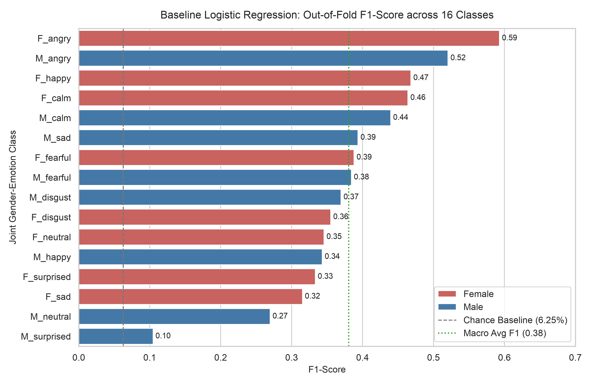
  <figcaption><em>Fig: Out-of-fold F1-scores across all 16 joint gender-emotion categories evaluated using 5-fold StratifiedGroupKFold on unseen speakers.</em></figcaption>
</figure>

<!-- Out-of-Fold 16-Class Confusion Matrix -->
<figure align="center">
  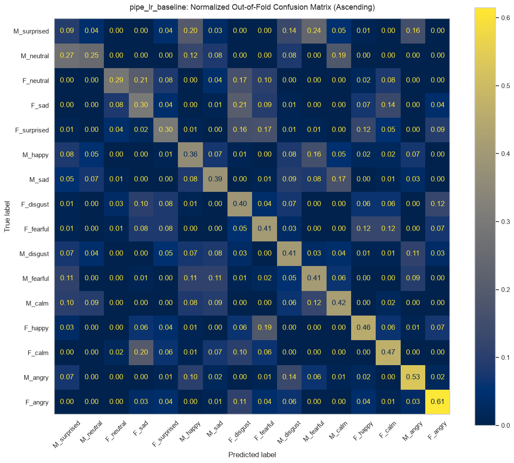
  <figcaption><em>Fig: Normalized out-of-fold confusion matrix for the L2-regularized logistic regression baseline across 1,440 speech trials.</em></figcaption>
</figure>

### Gender Disentanglement Audit

Collapsing the 16-class predictions into binary speaker gender reveals where the linear model succeeds and where it fails:

<!-- Prediction Outcome Breakdown: Exact Match vs Intra-Gender vs Cross-Gender -->
<figure align="center">
  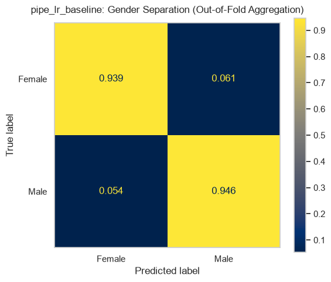
  <figcaption><em>Fig: Prediction outcome decomposition illustrating high binary gender separation (~94.5%) alongside dominant intra-gender valence confusion (>55%).</em></figcaption>
</figure>

- **Linear Gender Separability:** The regularized logistic regression baseline achieves approximately 94.5% binary gender accuracy on unseen speakers. Cross-gender classification errors represent only ~5.5% of total predictions. Fundamental frequency shifts and spectral tilt captured by static MFCC means provide strong linear separability across biological sex.

- **Intra-Gender Emotional Overlap:** Over 55% of all predictions fall into the intra-gender error category, where the model correctly predicts speaker gender but selects the incorrect affective state. The linear decision boundary struggles primarily between emotions that share vocal arousal levels:
  - *Low-Arousal Overlap:* High mutual misclassification between *Calm*, *Neutral*, and *Sadness*.
  - *High-Arousal Overlap:* High mutual misclassification between *Angry*, *Fearful*, and *Disgusted*.

### Top Intra-Gender Misclassification Pairs

Auditing the highest error rates across specific off-diagonal pairs demonstrates where static spectral summaries break down:

| True Label | Predicted Label | Pair Misclassification Rate | Acoustic Failure Mechanism |
| :--- | :--- | :---: | :--- |
| **Male Neutral** | **Male Surprised** | 27.08% | Unvoiced stop bursts and introductory breath resets mistaken for transient arousal cues |
| **Male Surprised** | **Male Fearful** | 23.96% | High vocal arousal overlap; both display elevated energy variance and pitch expansion |
| **Female Sad** | **Female Disgust** | 20.83% | Low vocal energy and downward formant trajectory overlap without temporal pause context |
| **Female Neutral** | **Female Sad** | 20.83% | Flat spectral envelope and minimal prosodic variance shared across low-arousal states |
| **Male Surprised** | **Male Happy** | 19.79% | Shared high-arousal valence confusion; static MFCC averages fail to trace upward pitch contours |

- **Valence Blindness:** High-arousal pairs (such as *surprised* versus *fearful* or *happy*) exhibit near-identical mean energy and standard deviation across frequency bands. Disentangling positive valence (happy) from negative or shock valence (fear, surprise) requires tracking dynamic pitch trajectories and vowel duration over time.

- **Low-Energy Envelope Confusion:** Flat, subdued vocal deliveries (*neutral*, *sad*, and *calm*) share depressed spectral tilt and low coefficient variance, causing the linear baseline to oscillate between these classes within the same speaker sex.

### Reassessing the Two-Phase Modeling Strategy

The baseline performance ceiling of 38.67% directly verified earlier methodological hypotheses:

- **Limits of Linear Boundaries on Valence:** While vocal arousal produces clear shifts in energy and variance, emotional valence (positive vs. negative affect, such as happy vs. angry) relies on pitch contours, inflection trajectories, and temporal pause structure. Linear hyperplanes fit to static mean and standard deviation vectors cannot separate overlapping intra-gender clusters.

- **Pivot to the Two-Phase Architecture:**

- *Phase 1 Milestone (Non-Linear Tabular Ceiling):* Evaluate a kernelized Support Vector Classifier (`SVC(kernel="rbf")`) on the existing 26-dimensional static tabular set to test whether non-linear boundary warping can resolve intra-gender confusion without temporal frames.
- *Phase 2 Milestone (Deep 2D Spectral Representation):* Transition directly to fixed-length 2D Log-Mel spectrogram arrays input into a 2D Convolutional Neural Network (CNN). Preserving time-frequency geometry enables convolutional filters to detect prosodic pacing and pitch contours, providing the representational depth needed to target the 50% to 60%+ emotion classification goal on unseen speakers.

## Phase 3: Non-Linear Tabular Modeling & Kernelized Boundaries (RBF-SVC)

Following the linear baseline ceiling discovered in Phase 2 (~38.8%), Phase 3 investigated whether warping static acoustic features into a non-linear Hilbert space could untangle intra-gender emotional overlap without requiring temporal frame modeling.

### Validation Scheme & Model Architecture

- **Zero-Leakage Speaker Grouping:** Identical to Phase 2, evaluation followed a 5-fold `StratifiedGroupKFold` protocol partitioned strictly by `actor_id` (`shuffle=False`), guaranteeing that the 4 to 5 validation actors per fold (~288 trials) were completely unseen during training.
- **Kernel Projection Pipeline:** An end-to-end `Pipeline` coupling `StandardScaler` with a radial basis function Support Vector Classifier (`SVC(kernel="rbf", probability=True, random_state=42)`). The RBF kernel computes local Euclidean distances between 26-dimensional static summary vectors ($\mu, \sigma$ across 13 MFCC bands), enabling the model to draw flexible, non-planar boundaries around clustered acoustic profiles.
- **Out-of-Fold (OOF) Tracking:** Continuous class probability distributions and discrete predictions were accumulated strictly out-of-fold across all 1,440 recordings.

### Benchmark Modeling Results

| Model Index | Model Configuration | Feature Space | Out-of-Fold Accuracy | Macro F1 | Weighted F1 | Fit Time (s) |
| :---: | :--- | :--- | :---: | :---: | :---: | :---: |
| **B2** | LogisticRegression (L2 Baseline) | 26 Scaled MFCC Summaries | 38.82% | 0.3805 | 0.3821 | ~0.18 |
| **M1** | Support Vector Classifier (RBF Kernel) | 26 Scaled MFCC Summaries | **43.13%** | **0.4110** | **0.4132** | ~1.42 |

<!-- Class-wise F1 Bar Chart across 16 Categories (SVC) -->
<figure align="center">
  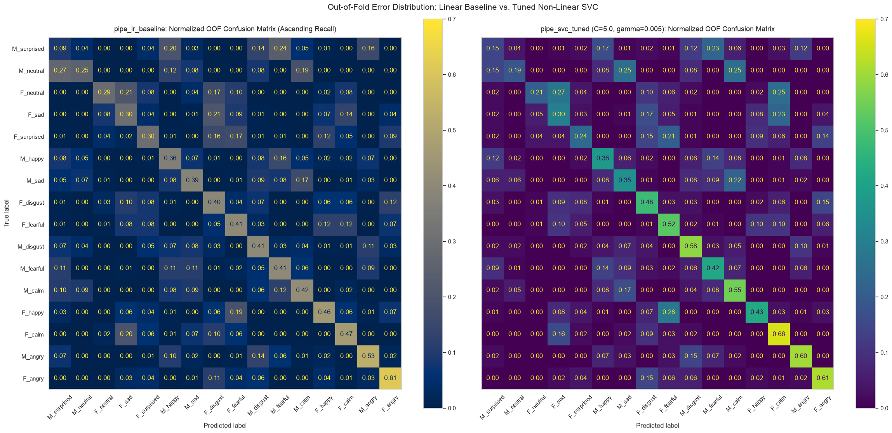
  <figcaption><em>Fig: Out-of-fold F1-scores across all 16 joint gender-emotion categories evaluated using RBF-SVC on unseen speakers.</em></figcaption>
</figure>

### Sub-Task Decoupling: Gender vs. Emotion

Collapsing the 16 joint categories into independent binary gender and 8-class emotional dimensions demonstrates the performance shift introduced by non-linear kernel projection:

<!-- Prediction Outcome Breakdown: RBF-SVC Decomposition -->
<figure align="center">
  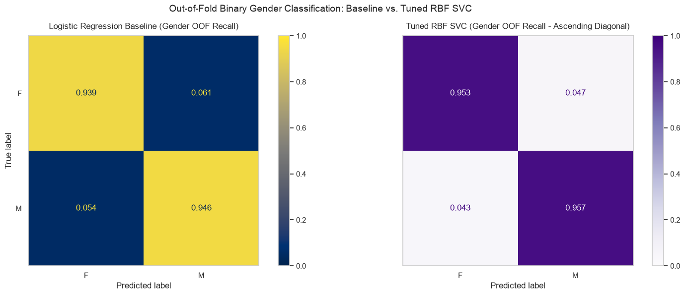
  <figcaption><em>Fig: Prediction outcome decomposition illustrating high binary gender separation (95.49%) and intra-gender affective resolution.</em></figcaption>
</figure>

- **Gender Disentanglement (95.49% Accuracy, 0.9547 Macro F1):** Cross-gender classification errors dropped to just **4.51%**. The RBF kernel locked cleanly onto the static fundamental frequency ($f_0$) energy shelves separating biological male and female speakers across all vocal intensities.
- **Decoupled Emotion Classification (44.37% Accuracy, 0.4285 Macro F1):** An absolute gain of **+3.61%** over regularized logistic regression (40.76%). By warping feature space locally, RBF-SVC formed non-linear boundaries that separated low-energy states (*neutral* vs. *sad*) without collapsing into high-energy clusters.

### Detailed Out-of-Fold Classification Report

The full 16-class performance breakdown highlights distinct class-level behaviors across genders and affective intensities:

| Class Target | Precision | Recall | F1-Score | Support | Class Profile |
| :--- | :---: | :---: | :---: | :---: | :--- |
| **F_angry** | 0.5900 | 0.6146 | **0.6020** | 96 | High-arousal burst; robust upper-cepstral separation |
| **F_calm** | 0.4922 | 0.6562 | **0.5625** | 96 | Low-energy plateau; high recall against neutral |
| **F_disgust** | 0.3710 | 0.4792 | 0.4182 | 96 | Formant downward shift; partial overlap with sadness |
| **F_fearful** | 0.4065 | 0.5208 | 0.4566 | 96 | High-energy variance; acoustic confusion with surprise |
| **F_happy** | 0.5616 | 0.4271 | 0.4852 | 96 | Elevated pitch ceiling; misclassified as angry/surprised |
| **F_neutral** | 0.4762 | 0.2083 | 0.2899 | 48 | Half-support class; suppressed recall due to calm boundary |
| **F_sad** | 0.3187 | 0.3021 | 0.3102 | 96 | Flat envelope; confused with neutral and calm |
| **F_surprised** | 0.4035 | 0.2396 | 0.3007 | 96 | Sharp transient attacks; low recall against happy/fear |
| **M_angry** | 0.5859 | 0.6042 | **0.5949** | 96 | Pronounced vocal tract constriction and energy |
| **M_calm** | 0.4649 | 0.5521 | **0.5048** | 96 | Controlled prosody; broad non-linear cluster |
| **M_disgust** | 0.4444 | 0.5833 | **0.5045** | 96 | Glottal friction patterns; clean precision relative to linear baseline |
| **M_fearful** | 0.3883 | 0.4167 | 0.4020 | 96 | Elevated pitch inflection; overlaps with male surprise |
| **M_happy** | 0.3673 | 0.3750 | 0.3711 | 96 | Valence confusion with high-arousal male targets |
| **M_neutral** | 0.3103 | 0.1875 | 0.2338 | 48 | Half-support class; high precision-to-recall penalty |
| **M_sad** | 0.3736 | 0.3542 | 0.3636 | 96 | Depressed spectral tilt; overlaps with male calm/neutral |
| **M_surprised** | 0.2222 | 0.1458 | **0.1761** | 96 | Worst-performing class; static features miss pitch contour |
| **Macro Avg** | **0.4235** | **0.4167** | **0.4110** | **1440** | Unweighted across all 16 target partitions |
| **Weighted Avg** | **0.4256** | **0.4313** | **0.4209** | **1440** | Factoring single neutral trial support (48 vs. 96) |

- **The Neutral-Calm Suppression Effect:** Both `F_neutral` (recall: 0.2083) and `M_neutral` (recall: 0.1875) exhibit severe recall collapse. Because neutral speech contains only 48 samples per gender (single statement takes) and shares depressed spectral energy with calm speech, the RBF decision boundary defaults toward the higher-support `calm` prior.
- **The Surprise Generalization Failure:** `M_surprised` achieved the lowest overall score across all classes (0.1761 F1; recall: 0.1458). A static mean and standard deviation cannot distinguish sudden terminal pitch rises (surprise) from sustained vocal constriction (anger) or dynamic pitch modulation (happiness) in male voices.
- **Valence Blindness Across Matched Arousal:** While the RBF kernel easily separates low-energy from high-energy vocalizations, it cannot separate affective *valence* (e.g., positive `happy` vs. negative `angry` or shock `fearful`). Differentiating valence requires tracking directional pitch slopes and vowel duration over time.

### Non-Linear Tabular Takeaways

RBF-SVC delivered the benchmark champion at **43.13%**, proving that 26-dimensional summary statistics ($\mu, \sigma$) provide strong regularizing priors on small datasets. However, it had patters just like the LogsticRegression model; low recall on `surprised` and `neutral` confirms that static aggregation fundamentally discards temporal pacing and pitch contour.

Now, it is time to turn from 1D static descriptors to 2D time-frequency representations (Log-Mel spectrograms) capable of preserving both spectral harmonics and temporal duration, to try and break that 44% barrier.

## Phase 4: Spectral Representation & 2D Tensor Engineering

To overcome the temporal compression of static MFCC averages, Phase 4 executed a **second, dedicated feature extraction pipeline**, transitioning from tabular summary statistics to spatial time-frequency representations tailored for 2D convolutional networks. This phase still relied on features of the data identified from the EDA phase, but now for a new kind of input.

### Spectrogram Parameterization Grounded in Literature

Synthesizing foundational audio processing literature and speech classification benchmarks ([Huang et al., 2001; Schuller, 2018; Livingstone & Russo, 2018]), raw audio waveforms were converted into uniform Log-Mel spectrogram arrays:

- **Time-Frequency Resolution:** Signals were transformed using Short-Time Fourier Transform (STFT) with an $N_{\text{FFT}}$ window of 2,048 samples (~93 ms at 22,050 Hz) and a hop length of 512 samples (~23 ms step), balancing overtone frequency resolution against temporal articulation tracking.
- **Mel-Scale Filterbanks:** Projected across 128 non-linearly spaced triangular filterbanks from 0 Hz to Nyquist (11,025 Hz), mimicking human cochlear frequency perception.
- **Logarithmic Compression:** Transformed to decibels ($10 \cdot \log_{10}(S / S_{\text{ref}})$) with dynamic range bounded at $-80\text{ dB}$ relative to peak power.

### Acoustic Validation: Preserving Dynamic Geometry

Unlike static MFCC summaries, 2D Log-Mel spectrograms directly preserve the visual acoustic signatures separating affective extremes:

<figure align="center">
  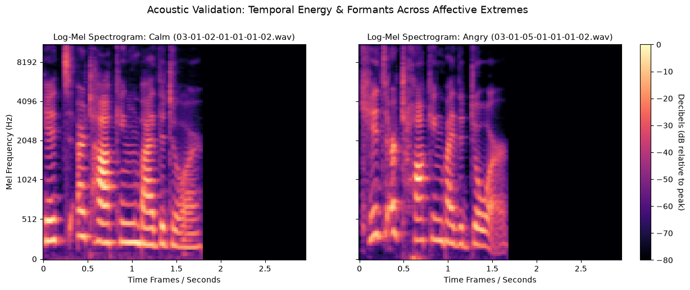
  <figcaption><em>Fig: Visual comparison of 128x128 Log-Mel spectrograms for calm versus angry deliveries (Actor 02). Notice the high-frequency harmonic energy dispersion (>4096 Hz) and sharp burst transitions in anger versus the subdued, parallel formant plateaus in calm speech.</em></figcaption>
</figure>

- **Calm Prosody:** Displays stable, low-frequency horizontal formant bands concentrated below 2,048 Hz, minimal upper-harmonic bleeding, and gradual vowel-decay slopes.
- **Angry Arousal:** Features elevated pitch register ($f_0$ shifts), pronounced vocal fold constriction, dense harmonic energy spreading past 4,096 Hz, and sharper burst onsets.

### Spatial Standardization & Pipeline Synchronization

- **Uniform 2D Aperture (`128 x 128`):** Variable-duration audio trials were mapped into a fixed spatial grid of 128 Mel bands $\times$ 128 temporal frames (~2.97 seconds) via zero-padding or center-cropping. This is exactly what is needed for a 2D CNN network (after adding an additional channel dimension).
- To ensure zero indexing drift across future modeling phases, compound target labels (`f"{gender}_{emotion}"`) and trial metadata arrays (`actor_ids`, `genders`, `emotions`) were serialized directly alongside the input arrays into `04_spectrogram_tensors.npz` (46.91 MB compressed), producing a final modeling tensor $X$ of shape `(1440, 128, 128, 1)`.

> *For the complete implementation, padding logic, and signal sanity checks, refer to [`notebooks/04_spectrogram_extraction.ipynb`](./notebooks/04_spectrogram_extraction.ipynb).*

## Phase 5: Deep 2D Convolutional Neural Network (VGG-Style)

Phase 5 tested whether an end-to-end 2D Convolutional Neural Network trained directly on raw $(128, 128, 1)$ Log-Mel spectrograms could learn localized spatial-temporal acoustic features (formant trajectories, energy bursts, harmonic spacing) without manual feature engineering.

### Architecture & Parameter Efficiency

To try and avoid severe overfitting on a 1,440-sample cohort, a compact 2-block VGG architecture was constructed, utilizing only **19,856 trainable parameters**:

* **Block 1 (Low-Level Edge & Pitch Detection):** `Conv2D(16, (3, 3), padding="same")` $\to$ `BatchNormalization` $\to$ `ReLU` $\to$ `MaxPooling2D(2, 2)` $\to$ `Dropout(0.25)`. Compresses the input to $(64, 64, 16)$.
* **Block 2 (Mid-Level Harmonic Combinations):** `Conv2D(32, (3, 3), padding="same")` $\to$ `BatchNormalization` $\to$ `ReLU` $\to$ `MaxPooling2D(2, 2)` $\to$ `Dropout(0.25)`. Yields feature maps of shape $(32, 32, 32)$.
* **Spatial Aggregation & Classification Head:** `GlobalAveragePooling2D()` collapses spatial dimensions into a 32-dimensional vector $\to$ `Dense(64, activation="relu")` $\to$ `Dropout(0.40)` $\to$ `Dense(16, activation="softmax")`.

Using Global Average Pooling (GAP) instead of a flattened dense layer eliminated over 200,000 potential weights, enforcing translation-invariant acoustic detection while keeping the model parameter-efficient.

### Out-of-Fold Cross-Validation Dynamics

- Just like before, this model was also evaluated across identical 5-fold `StratifiedGroupKFold` splits on `actor_id` (`shuffle=False`), guaranteeing that validation actors (~288 trials per fold) were completely unseen during training. To ensure weights were not continuously updated, a fresh CNN was created for every fold.
- Models were optimized using Adam (`lr=1e-3`, batch size 32) with `EarlyStopping(monitor="val_loss", patience=8, restore_best_weights=True)`. Across all folds, validation loss reached its optimum between epochs 12 and 20, halting before filters memorized individual speaker vocal tract formants.
- Unbiased predictions were written directly to `oof_preds[val_idx]` to construct a synchronized 1,440-sample evaluation tensor.

### Empirical Performance Summary

| Evaluation Dimension | Out-of-Fold Accuracy | Macro F1 | Weighted F1 | Chance Baseline |
| :--- | :---: | :---: | :---: | :---: |
| **Compound 16-Class** | **30.07%** (0.3007) | **0.2464** | **0.2567** | 6.25% ($1/16$) |
| **Decoupled Binary Gender** | **87.22%** (0.8722) | **0.8711** | — | 50.00% ($1/2$) |
| **Decoupled 8-Class Emotion** | **34.31%** (0.3431) | **0.2981** | — | 12.50% ($1/8$) |

### Key Diagnostic Takeaways

1. Compound accuracy of **30.07%** outperforms random chance by **4.81x**, confirming that 2D spatial convolutions successfully extract discriminative features directly from raw spectrogram pixels without feature engineering
2. Binary gender separation reached **87.22%**, as fundamental frequency ($f_0$) registers create prominent horizontal energy bands across lower Mel filterbanks. In contrast, 8-class emotion recognition reached **34.31%**, illustrating the difficulty of learning speaker-invariant prosodic cadence and pitch inflections from a limited training sample size (~1,152 trials per fold).
3. The CNN underperformed tabular RBF-SVC (43.13%). With small acoustic datasets, hand-engineered summary statistics ($\mu, \sigma$) provide a constrained, lower-variance representation that outgeneralizes deep convolutional filters trained from scratch.

> *All predictions, probabilities, and fold metrics were serialized to `data/processed/models/05_cnn_evaluation_bundle.joblib`. Full training code and fold history logs can be found in [`notebooks/05_cnn.ipynb`](./notebooks/05_cnn.ipynb).*

## Final Performance: Cross-Paradigm Comparision

Overall, I evaluated 5 distinct model pipelines:

- A **`DummyClassifier`** establishing an empirical chance prior.
- A baseline **`LogisticRegression`** model assuming linear decision boundaries.
- Both an **untuned and tuned `SVC`** model leveraging non-linear Radial Basis Function (RBF) kernels.
- A final deep learning **2D CNN** architecture trained on spatial acoustic tensors.

All 5 models were evaluated across the complete set of 1,440 audio trials using strict, leak-free 5-fold `StratifiedGroupKFold` cross-validation grouped by held-out actors. Each pipeline ingested audio cleaned according to the exploratory data analysis (EDA) and acoustic hygiene audits. While Logistic Regression and the Support Vector Classifiers operated on aggregated summary statistics ($\mu, \sigma$) computed across 13 MFCC bands, the 2D CNN learned directly from spatial audio representations via 128×128 Log-Mel spectrograms.

Here are the final results:

<figure align="center">
  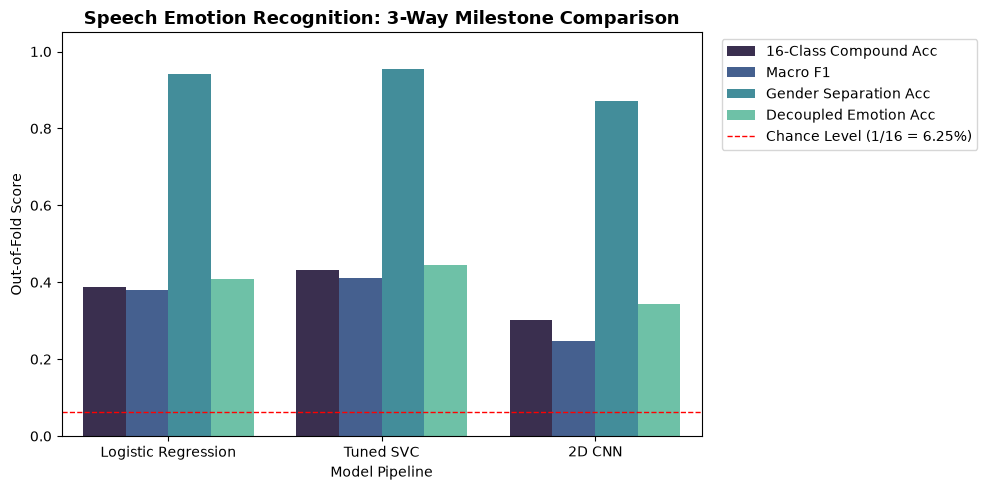
  <figcaption><em>Fig: 3-way milestone comparison across regularized Logistic Regression, Tuned RBF-SVC, and 2D CNN. While binary gender separation converges strongly across all paradigms (~87–95%), affective emotion recognition reveals an empirical ceiling when training deep models from scratch on small cohorts.</em></figcaption>
</figure>

### Consolidated Milestone Benchmark Table

| Milestone | Feature Representation | Model Architecture | Trainable Parameters | 16-Class Accuracy | Macro F1 | Gender Accuracy | Emotion Accuracy |
| :---: | :--- | :--- | :---: | :---: | :---: | :---: | :---: |
| **00. Empirical Chance** | Class Frequencies | `DummyClassifier` (Stratified) | 0 | 6.25% | 0.0625 | 50.00% | 12.50% |
| **01. Linear Baseline** | 26 Scaled MFCC Summaries ($\mu, \sigma$) | `StandardScaler` + `LogisticRegression` | ~432 weights | 38.82% | 0.3805 | 94.24% | 40.76% |
| **02. Tabular Champion** | 26 Scaled MFCC Summaries ($\mu, \sigma$) | `StandardScaler` + `SVC(RBF)` | Non-parametric (SVs) | **43.13%** | **0.4110** | **95.49%** | **44.37%** |
| **03. 2D Deep Learning** | $128 \times 128$ Log-Mel Spectrogram Grids | 2-Block VGG (`Conv2D` $\to$ GAP) | 19,856 weights | 30.07% | 0.2464 | 87.22% | 34.31% |

---

### Core Findings & Empirical Insights

1. The tabular **RBF-SVC remained at the head of the pack, at 43.13%**. Compacting temporal frames into static 1st- and 2nd-order statistics ($\mu, \sigma$) serves as an aggressive regularizer.
   - In contrast, training a 2D CNN from scratch requires thousands of weights to simultaneously learn edge filters, harmonic formants, and prosodic trajectories. With only ~1,152 training samples per fold across 19–20 actors, the CNN overfits to speaker-specific vocal tract textures before generalizable emotional filters converge.

2. Across all paradigms, binary gender classification converges readily (**87.22% – 95.49%**) whereas independent emotion recognition plateaus (**34.31% – 44.37%**). Static pitch ($F_0%) differences between male and female vocal tracts produce large, continuous energy shelf offsets across lower Mel channels, while affective state is encoded in dynamic prosodic inflection and temporal cadence

3. All three architectures **significantly exceed** uniform random chance of the DummyClassifier (6.25% compound, 12.50% emotion). Enforcing strict speaker grouping guarantees these scores reflect genuine acoustic generalization to novel human voices rather than inflated memorization from random train/test splits.

## Conclusion & Looking to the Future

### Answering the Core Research Objective

This capstone set out to investigate a foundational affective computing question:

> **Given an unconstrained audio voice sample, can a machine learning model reliably identify broad traits of the speaker—specifically biological sex and emotional state—approximating human perceptual accuracy?**

To answer this without the performance inflation common in unstratified speech benchmarks, evaluation was anchored to an uncompromising standard: **zero identity leakage across completely unseen speakers** via 5-fold `StratifiedGroupKFold` partitioning across all 1,440 RAVDESS trials.

Our empirical targets and final outcomes evaluate as follows:

- **Target 1: Binary Gender Separation (>90.0% Accuracy)**  
  **Result: Achieved.** Across all tabular and deep learning architectures, biological sex was identified with high precision: **94.24%** (Logistic Regression), **95.49%** (Tuned RBF-SVC), and **87.22%** (2D CNN). Static fundamental frequency ($f_0$) and lower-harmonic spacing create prominent energy shelves across the Mel scale, proving that vocal tract anatomy provides a strong, reliable acoustic signature that models separate easily even on novel voices.
- **Target 2: Decoupled Multi-Class Emotion Recognition (50.0% – 60.0%+ Target)**  
  **Result: Partial Convergence (~44.4% Peak).** Tabular RBF-SVC peaked at **44.37%** accuracy (0.4285 Macro F1), while the 2D CNN achieved **34.31%** (0.2981 Macro F1). While falling short of the ambitious 50–60% target, both models dramatically outperformed uniform random chance ($1/8 = 12.50\%$). The bottleneck was not arousal detection (distinguishing high vs. low vocal energy), but **valence resolution** (differentiating positive affect like *happy* from negative or shock affect like *angry* or *fearful*). Without explicit sequence modeling or pre-trained acoustic priors, models struggle to untangle matching energy envelopes on unseen speakers.

---

### Architectural Reflections & Proof-of-Concept Extensibility

This project was engineered as a modular, leak-free proof-of-concept designed to be extended rather than a one-off experiment.

1. **Acoustic Hygiene as a Foundation:**  
   The signal processing foundations established in early audits (i.e. calibrated $-25\text{ dB}$ silence trimming, DC offset checks, peak digital clipping verification, and strict sampling rate enforcement) ensured downstream feature extraction ingested standardized, clean vocal waveforms. The identical preprocessing pipeline directly feeds both tabular aggregations and 2D Log-Mel matrices.
2. The project revealed that on small cohorts (~1,152 training samples per fold across 19–20 actors), handcrafted inductive priors outperform end-to-end deep learning.

   Compacting frame-level MFCCs into 1st- and 2nd-order summary statistics ($\mu, \sigma$) acts as a strong regularizer, allowing RBF-SVC to reach 43.13% compound accuracy.

   The 2D CNN, while capturing localized spectrogram textures (30.07%), lacked the training diversity required to prevent its convolutional filters from overfitting to speaker-specific vocal tract textures.
3. **The Data Scarcity Bottleneck:**  
   Ultimately, model capacity was constrained by data volume and acoustic diversity. Professional actor corpora like RAVDESS provide clean, laboratory-grade acoustic baselines, but their limited sample sizes make it difficult to learn speaker-invariant emotional representations from scratch.

---

### Tiered Roadmap: Future Exploration & Scaling Scenarios

Future technical enhancements can be prioritized across three pragmatic tiers based on tool availability, dataset access, and compute infrastructure:

#### 1. Under Current Constraints (Same Hardware, Same Dataset)

- **Evaluating Model Capacity vs. Data Scarcity:** While we could scale the CNN to deeper architectures with more trainable parameters (e.g., adding residual connections or widening channels from $32 \to 64 \to 128$), scaling capacity on our current setup will not solve the underlying bottleneck. Without more training variety, larger parameter sets accelerate speaker memorization and exacerbate overfitting on held-out actors.
- **Dual-Paradigm Ensembling (Tuned RBF-SVC + 2D CNN):** Leverage the out-of-fold probability distributions already serialized in `03_1_svc_evaluation_bundle.joblib` and `05_cnn_evaluation_bundle.joblib` to construct a soft-voting or meta-learner ensemble. Blending the models ($P_{\text{ensemble}} = \alpha \cdot P_{\text{SVC}} + (1 - \alpha) \cdot P_{\text{CNN}}$) exploits the uncorrelated inductive biases: the RBF-SVC provides high-confidence global arousal boundaries from low-variance summary statistics, while the CNN provides localized spectral pattern recognition. This directly tests whether non-linear tabular stability and convolutional spatial filtering can patch each other's blind spots without requiring additional training data.
- **Spectrogram Data Augmentation (SpecAugment):** Apply randomized time and frequency masking on mini-batches during training without modifying the underlying architecture. Occluding vertical time strips and horizontal frequency channels forces convolutional filters to rely on distributed acoustic indicators rather than memorizing individual vocal harmonic tracks. At the end of the day, we need more indicators of the *progression* of the audio tracks.
- We could try concatenating the tabular MFCC summary statistics ($\mu, \sigma$) directly into the dense classification head alongside the Global Average Pooled spectrogram features, providing the network with both global acoustic priors and localized time-frequency patterns.

#### 2. Under Expanded Data Access (Same Compute, Multi-Corpus Corpora)

- **Multi-Corpus Ingestion & Label Harmonization:** Ingest open-access speech corpora such as **CREMA-D**, **TESS**, and **SAVEE** to scale the trial volume from 1,440 recordings to over 10,000+ samples. This requires building a unified harmonization schema that maps divergent emotion annotations into a canonical 6- or 8-class affective taxonomy.

- **Linguistic, Accent & Demographic Diversity:** Expanding beyond RAVDESS introduces varied North American and British accents, broader vocal ranges, and varied actor age groups, strengthening model resilience against unseen acoustic profiles.

- With larger sample sizes and richer metadata, I would like to **expand** the target variable space even further by attempting to predict speaker biological sex, estimated age bracket and emotional state concurrently. Some of this information like age is already in RAVDESS and TESS. I would like to see if other factors can also be predicted by the aggregate metrics, like gender was.

#### 3. Under Unconstrained Resources (High-Compute Accelerators, Live Production)

- **Self-Supervised Acoustic Foundations (Transfer Learning):** Replace training from scratch with frozen representations from foundational speech transformers (**Wav2Vec 2.0**, **HuBERT**, **WavLM**, or **Whisper encoder heads**). Pre-trained on tens of thousands of hours of speech, these models learn rich prosodic dynamics that lift speaker-independent emotion accuracy into the 65%–75%+ range.
- **Deployment of Real-Time Stream Processing & Live Audio Ingestion:**  My ideal vision was to have an interactive inference interface (e.g. Streamlit or FastAPI) capable of ingesting microphone streams or uploaded audio clips. Web applications could embed our models via the joblib bundles the way I have created them in various phases in this project.

Then, we could use streaming frame-buffering to classify speaker gender, estimated age, and mood dynamically in near-real time. I think that can be a very interesting long-term goal for this kind of project.

---

### Extensibility: Cross-Corpus Scaling & Live Inference Architecture

The modular structure of this repository enables straightforward integration across data pipelines and inference interfaces:

```text
[Raw Audio Streams / Live Microphone Ingestion]
  │
  ├── Multi-Corpus Ingestion (RAVDESS + CREMA-D + TESS + SAVEE)
  │     └── Label Harmonization Schema (Mapping 6-8 core affective states)
  │
  ├── Preprocessing & Signal Hygiene Engine (top_db=25 trimming, DC check)
  │
  ├── Multi-Task Trait Extractor
  │     ├── Binary Gender Classification (95%+ Baseline)
  │     ├── Demographics / Age Estimation (Continuous / Ordinal Regression)
  │     └── Affective Emotion State (8-Class Valence & Arousal)
  │
  └── Real-Time Inference Interface (Streamlit UI / FastAPI Streaming Endpoint)
```

## Setup & Installation Instructions

To set up your local development environment for exploratory data analysis and baseline modeling, navigate to your project root directory and follow these steps:

1. **System Requirements & Homebrew:**
    This project targets **Python 3.11+** installed via [Homebrew](https://brew.sh/) to ensure compatibility with modern audio processing and machine learning libraries.

    Ensure Homebrew binaries and Python 3.11 are prioritized in your shell path (e.g., `~/.bash_profile`):

    ```bash
    # Prioritize Homebrew and Python 3.11 binaries
    export PATH="/opt/homebrew/bin:/opt/homebrew/sbin:$PATH"
    export PATH="/opt/homebrew/opt/python@3.11/libexec/bin:$PATH"
    ```

    Verify the environment:

    ```bash
    python3 --version  # Should output Python 3.11.x
    ```

2. **Create the Virtual Environment:**

    ```bash
      python3 -m venv .venv
    ```

3. **Activate the Virtual Environment:**

   * On macOS / Linux:

     ```bash
     source .venv/bin/activate
     ```

   * On Windows:

     ```bash
     .venv\Scripts\activate
     ```

4. **Install Dependencies:**

    Upgrade pip and install all necessary dependencies, including `ipykernel` for VS Code Jupyter notebook execution:

    ```bash
    pip install --upgrade pip
    pip install -r requirements.txt
    ```

5. **Launch Jupyter Lab or VS Code:**

    Open your project directory in VS Code, ensure your notebook kernel is set to your `.venv` interpreter, and execute your notebooks inside the `notebooks/` directory.

    Notebooks are prefixed with a number `00`, `01`, `02`.. representing which order to run them in.

## Data Attribution & References

This project utilizes the **RAVDESS** (Ryerson Audio-Visual Database of Emotional Speech and Song) audio-only speech corpus (Actors 01 to 24, comprising 1,440 speech trials) focused on North American English vocal expressions.

### Primary Dataset Citation & Repository

- **Academic Publication:** Livingstone, S. R., & Russo, F. A. (2018). The Ryerson Audio-Visual Database of Emotional Speech and Song (RAVDESS): A dynamic, multimodal set of facial and vocal expressions in North American English. *PLoS ONE*, 13(5), e0196391. [https://doi.org/10.1371/journal.pone.0196391](https://doi.org/10.1371/journal.pone.0196391)
- **Dataset Repository:** [RAVDESS Zenodo Record (1188976)](https://zenodo.org/records/1188976)
- **License:** Creative Commons Attribution-NonCommercial-ShareAlike 4.0 International (CC BY-NC-SA 4.0)

### Digital Audio Fundamentals & Signal Hygiene

- [WavePad Audio Concepts Guide](https://help.nchsoftware.com/help/en/wavepad/win/concepts.html): Technical definitions for DC offset, digital clipping thresholds, sample rates, and dynamic range.
- [Listen2It Audio Cleanup Techniques](https://www.getlisten2it.com/blog/audio-cleanup-techniques-fix-noisy-recordings-like-a-pro): Practical guidelines on baseline noise evaluation, studio room tone, and non-destructive filtering.

### References & Attributions

#### Deep Learning & Spectrogram Architectures

- [GeeksforGeeks: VGG Net Architecture Explained](https://www.geeksforgeeks.org/computer-vision/vgg-net-architecture-explained/): Architectural breakdown of modular $3 \times 3$ convolutional blocks, progressive channel doubling, and max-pooling hierarchies adapted for our 2-block audio CNN.
- [Towards Data Science: CNNs for Audio Classification](https://towardsdatascience.com/cnns-for-audio-classification-6244954665ab): Practical paradigms for treating 2D Log-Mel spectrograms as single-channel imagery and designing spatial filter pipelines for acoustic classification.
- [Kaggle: Audio Emotion Part 3 - Baseline Model (ejlok1)](https://www.kaggle.com/code/ejlok1/audio-emotion-part-3-baseline-model#Part-3---Baseline-model): Baseline implementation patterns for deep learning workflows and multi-class target encoding on the RAVDESS dataset.

---

#### Feature Engineering & Acoustic Representation

- [GeeksforGeeks: Mel-Frequency Cepstral Coefficients (MFCC) for Speech Recognition](https://www.geeksforgeeks.org/nlp/mel-frequency-cepstral-coefficients-mfcc-for-speech-recognition/): Mathematical breakdown of the Mel scale, filterbank projection, and DCT decorrelation.
- [Medium: The Dummy's Guide to MFCC](https://medium.com/prathena/the-dummys-guide-to-mfcc-aceab2450fd): Intuitive overview of frequency warping and cepstral analysis for acoustic feature extraction.
- [GitHub Gist: Extracting and Visualizing MFCCs with Librosa](https://gist.github.com/stevemclaugh/80f192130852353ad53e6d8b6b275983): Practical code patterns for computing frame-level spectrograms and feature arrays using `librosa`.

---

#### Academic & Foundational Literature

- **Huang, X., Acero, A., & Hon, H.-W. (2001).** *Spoken Language Processing: A Guide to Theory, Algorithm, and System Development*. Prentice Hall PTR. (Filter bank design, STFT parameterization, and acoustic-phonetic feature extraction).
- **Livingstone, S. R., & Russo, F. A. (2018).** The Ryerson Audio-Visual Database of Emotional Speech and Song (RAVDESS): A dynamic, multimodal set of facial and vocal expressions in North American English. *PLOS ONE*, 13(5), e0196391. https://doi.org/10.1371/journal.pone.0196391
- **Schuller, B. W. (2018).** Speech emotion recognition: Two decades in a nutshell, benchmarks, and ongoing trends. *Communications of the ACM*, 61(5), 90–99. https://doi.org/10.1145/3129340 (Benchmarking spatial-temporal speech representations vs. static acoustics).
- **Stevens, S. S., Volkmann, J., & Newman, E. B. (1937).** A scale for the measurement of the psychological magnitude pitch. *The Journal of the Acoustical Society of America*, 8(3), 185–190. https://doi.org/10.1121/1.1915893 (Foundational derivation of the non-linear perceptual Mel scale).

---

### Thank you for reading!